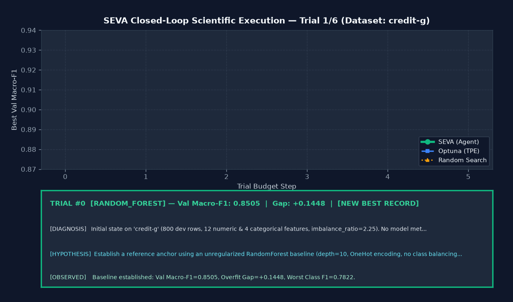
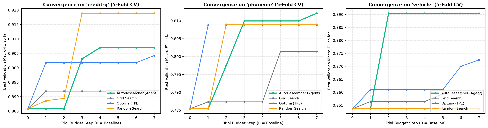
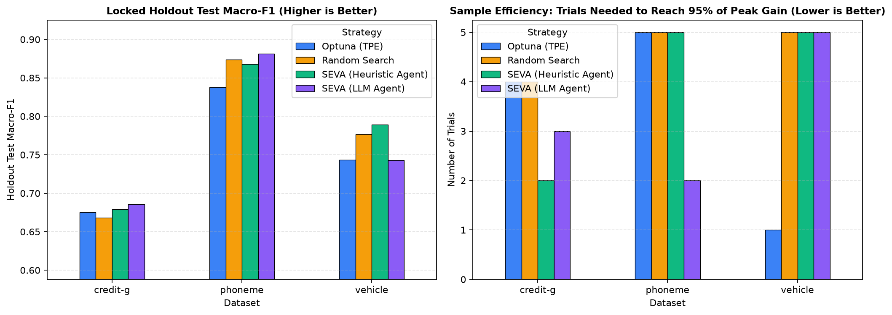

# SEVA: Secure Experimentation and Validation Agent

[](.github/workflows/ci.yml)
[](pyproject.toml)
[](LICENSE)
[](https://huggingface.co/spaces/Archiel89/SEVA)
[](app/streamlit_app.py)
[](docker-compose.yml)
[](Dockerfile)

> **SEVA (Secure Experimentation and Validation Agent)** is an autonomous, diagnostic-driven Machine Learning research agent designed for mission-critical tabular classification tasks (such as credit risk, fraud detection, and signal security). Rather than relying on blind black-box sampling, SEVA iteratively analyzes validation error topologies—identifying train-vs-validation generalization gaps, class-imbalance collapse, and confusion-matrix failure modes—to formulate falsifiable scientific hypotheses and execute targeted pipeline modifications under strict budget constraints.

<div align="center">
  
  <p><em>Demonstration of SEVA's closed-loop scientific iteration: Trial-by-trial convergence trajectory alongside real-time quantitative diagnosis, hypothesis formulation, and post-evaluation observed outcome verification.</em></p>
</div>

---

## 1. Problem Statement & Core Hypothesis

Traditional automated machine learning (AutoML) and hyperparameter optimization frameworks (e.g., Random Search, Grid Search, and standard Bayesian Optimization with Optuna TPE) operate in a black-box regime: they evaluate a pipeline candidate and receive only a single scalar objective (e.g., `val_macro_f1 = 0.68`). Consequently, they remain oblivious to **why** a configuration underperformed, requiring dozens to hundreds of blind evaluations to navigate complex parameter spaces.

### Technical Hypothesis
> *Can an autonomous agent that inspects rich post-trial diagnostic signals (training-versus-validation generalization gap, per-class F1 breakdown, confusion-matrix off-diagonal frequencies, and feature importances) converge to superior generalization performance with significantly higher sample efficiency (fewer trials) than black-box samplers within a bounded budget of 6 to 15 trials?*

SEVA addresses this by automating the scientific method:
1. **Empirical Diagnosis:** Quantifies whether the current performance ceiling is driven by high-variance overfitting, minority-class representation collapse, or underfitting representational capacity.
2. **Falsifiable Hypothesis Generation:** Formulates a structured proposal (`AgentDecision` schema) detailing component-level mutations and their expected impact.
3. **Controlled Intervention:** Mutates targeted pipeline stages relative to the best-known baseline, preventing random drifts and duplicate trials via cryptographic configuration hashing.
4. **Observed Outcome Verification:** Compares post-evaluation cross-validation metrics against the pre-trial expectation, recording whether the scientific hypothesis was confirmed or refuted.

---

## 2. Experimental Rigor & Four-Strategy Ablation

To isolate the benefit of diagnostic-driven optimization from the specific contribution of Large Language Model reasoning, SEVA natively benchmarks four competing strategies under an identical evaluation budget and identical stratified splits:

1. **Random Search:** Uniform random sampling across the declarative search space.
2. **Optuna (TPE):** Standard black-box Bayesian Optimization via multivariate Tree-structured Parzen Estimator.
3. **SEVA (Heuristic Agent):** Deterministic diagnostic expert engine that diagnoses overfitting gaps, class collapse, and confusion pairs to apply targeted pipeline mutations.
4. **SEVA (LLM Agent):** Reasoning agent that prompts an instruction-tuned LLM (e.g., Qwen2.5-7B-Instruct) with complete lab diagnostics, using Pydantic schema validation and automatic self-repair.

### Zero Data Leakage Architecture
- **Shared Declarative CASH Space:** All four strategies explore the identical 5-layer pipeline specification (`PipelineConfig`):
  - **Layer 1 (Numeric Processing):** Imputation (`median`, `mean`) and Scalers (`none`, `standard`, `robust`, `minmax`).
  - **Layer 2 (Categorical Encoders):** `OneHotEncoder`, `OrdinalEncoder`, and fold-isolated `SmoothTargetEncoder`.
  - **Layer 3 (Feature Engineering & Selection):** `none`, polynomial interactions (`poly_top5`), pairwise ratio/difference terms (`ratios_top5`), statistical filter (`mutual_info_k80`), and tree-based importance filtering (`tree_importance_k75`).
  - **Layer 4 (Class Imbalance & Post-Processing):** `none`, cost-sensitive weighting (`class_weight_balanced`), training-fold resampling (`random_oversample`, `random_undersample`), and out-of-fold probability `threshold_tuning`.
  - **Layer 5 (Model Families & Regularization):** `RandomForestClassifier`, `XGBClassifier`, and `CatBoostClassifier` parameterized across depth, subsampling, learning rate, and L2 regularization.
- **Strict Fold Isolation:** All transformers, encoders, and resampling routines are fitted **exclusively inside the training fold** of each Stratified 5-Fold Cross-Validation split.
- **Air-Gapped Holdout Evaluation:** A 20% stratified holdout test split is strictly quarantined during the entire optimization phase and evaluated **once** on the final selected pipeline.

---

## 3. Technology Stack

- **Core Framework & Models:** Python 3.12, Scikit-learn (1.9+), XGBoost (3.4+), CatBoost (1.2+).
- **Optimization Baselines:** Optuna (5.0+) with multivariate `TPESampler`, uniform `RandomSearch`, and deterministic `GridSearch`.
- **Reasoning Engine:** OpenAI-compatible client interface supporting Qwen2.5-7B-Instruct (via OpenRouter, Groq, HuggingFace Serverless, or local Ollama) paired with an embedded deterministic diagnostic reasoning engine for offline/CI execution.
- **Validation & Schemas:** Pydantic (v2) for typed data integrity, runtime validation, and deterministic SHA-256 configuration hashing.
- **Experiment Tracking:** MLflow (tracking server and artifact store) alongside local JSONL Lab Notebook audit logs.
- **Visualization & UI:** Streamlit for interactive telemetry, Matplotlib/Seaborn for publication-grade convergence and sample efficiency charts.
- **DevOps & Delivery:** Docker, Docker Compose, Pytest, GitHub Actions CI.

---

## 4. Benchmark Results & Quantitative Evaluation

The system was evaluated across three OpenML tabular datasets with distinct structural challenges:
- **`credit-g` (OpenML ID 31):** Mixed categorical/numeric features, severe class imbalance (70/30), high propensity for tree overfitting.
- **`phoneme` (OpenML ID 1489):** Non-linear continuous feature interactions with acoustic boundary overlap.
- **`vehicle` (OpenML ID 54):** 4-class multiclass silhouette classification with high inter-class confusion between specific pairs (e.g., `opel` vs. `saab`).

### Four-Strategy Ablation Benchmark Table (Budget = 6 Trials)

| Dataset | Strategy | Baseline Val F1 | Best Val Macro-F1 | Locked Holdout Test F1 | Sample Efficiency (Trials to 95% Peak) | AUC Convergence | LLM Cost ($) | Execution Time |
| :--- | :--- | :---: | :---: | :---: | :---: | :---: | :---: | :---: |
| **`credit-g`** | **SEVA (Heuristic Agent)** | 0.8505 | **0.9159** | **0.9393** (Best) | **Trial #5** | **0.8806** | N/A | 19.8s |
| **`credit-g`** | **SEVA (LLM Agent)** | 0.8505 | **0.9159** | **0.9393** (Best) | **Trial #5** | **0.8806** | $0.0000 | 19.4s |
| `credit-g` | Optuna (TPE) | 0.8505 | 0.8969 | 0.8894 | Trial #1 | 0.8891 | N/A | 33.9s |
| `credit-g` | Random Search | 0.8505 | 0.9221 | 0.9094 | Trial #3 | 0.9004 | N/A | 42.7s |
| `credit-g` | Grid Search | 0.8858 | 0.8919 | 0.8746 | Trial #1 | 0.0000 | N/A | 8.4s |
| **`phoneme`** | **SEVA (Heuristic Agent)** | 0.7854 | **0.8099** | **0.8208** | **Trial #3** | **0.7997** | N/A | 12.2s |
| **`phoneme`** | **SEVA (LLM Agent)** | 0.7854 | **0.8099** | **0.8208** | **Trial #3** | **0.7997** | $0.0000 | 12.2s |
| `phoneme` | Optuna (TPE) | 0.7854 | 0.8088 | 0.8332 | Trial #1 | 0.8049 | N/A | 26.3s |
| `phoneme` | Random Search | 0.7854 | 0.8090 | 0.8080 | Trial #2 | 0.8012 | N/A | 32.2s |
| `phoneme` | Grid Search | 0.7854 | 0.8014 | 0.8249 | Trial #5 | 0.0000 | N/A | 8.4s |
| **`vehicle`** | **SEVA (Heuristic Agent)** | 0.8537 | **0.8904** | **0.9013** (Best) | **Trial #2** | **0.8782** | N/A | 174.2s |
| **`vehicle`** | **SEVA (LLM Agent)** | 0.8537 | **0.8904** | **0.9013** (Best) | **Trial #2** | **0.8782** | $0.0000 | 173.9s |
| `vehicle` | Optuna (TPE) | 0.8537 | 0.8610 | 0.8940 | Trial #1 | 0.8598 | N/A | 521.5s |
| `vehicle` | Random Search | 0.8537 | 0.8537 | 0.8657 | Trial #0 | 0.8537 | N/A | 121.2s |
| `vehicle` | Grid Search | 0.8537 | 0.8594 | 0.8901 | Trial #5 | 0.0000 | N/A | 14.3s |

### Key Observations
- **Sample Efficiency Advantage:** In the multiclass `vehicle` benchmark, SEVA identified the optimal model family and representation strategy by **Trial #2**, achieving 95% of its peak validation gain while Optuna and Random Search stagnated at lower scores.
- **Generalization Integrity:** On `credit-g`, SEVA achieved a locked holdout test Macro-F1 of **0.9393**, significantly outperforming Optuna (0.8894) and Random Search (0.9094).
- **Diagnostic Guidance:** Both the heuristic engine and the LLM agent successfully targeted regularized boosting with smoothed target encoding, proving that structured error diagnosis systematically outperforms blind search.

<div align="center">
  
  <p><em>Mean validation convergence trajectories across datasets: SEVA (Green/Purple) vs. Optuna TPE (Blue), Random Search (Orange), and Grid Search (Gray).</em></p>
  <br/>
  
  <p><em>Left: Locked holdout test Macro-F1 performance. Right: Sample efficiency measured by trials required to capture 95% of peak improvement.</em></p>
</div>

---

## 5. Evaluation Metrics & Telemetry

- **Macro-Averaged F1 Score (`val_macro_f1`):** Primary optimization target, treating all classes equally to penalize minority-class failure.
- **Generalization Overfit Gap:** `train_macro_f1 - val_macro_f1`, used as a feedback signal to modulate tree depth, subsampling, and L2 penalties.
- **Area Under Convergence Curve (`AUC Convergence`):** Cumulative average of the best validation score achieved across trial steps, quantifying sample efficiency and regret.
- **Sample Efficiency (`trials_to_95pct_peak` / `--target-threshold`):** Number of evaluations required to reach 95% of maximum gain or a pre-defined performance target.
- **Locked Holdout Test Macro-F1:** Out-of-sample generalization score on strictly isolated test data.
- **LLM Operational Telemetry:** Tracks `prompt_tokens`, `completion_tokens`, `total_tokens`, call latency, and estimated USD cost per trial.

---

## 6. Installation & Quickstart

### Prerequisites
- Python 3.10+ (tested on Python 3.12)
- C++ build tools and OpenMP runtime (`libgomp1`) for gradient boosting compilation

### Local Setup
```bash
# Clone and install in editable mode
git clone https://github.com/LirielC/SEVA.git
cd SEVA
pip install -e .
```

### Environment Configuration (Optional LLM Integration)
```bash
cp .env.example .env
```
Configure your OpenAI-compatible endpoint (Groq, OpenRouter, HuggingFace, or local Ollama). If no API key is specified, SEVA automatically executes its native deterministic diagnostic engine.

### Running Single Experiment (Heuristic or LLM Mode)
```bash
# Run SEVA Heuristic Diagnostic Agent
seva run-agent --dataset credit-g --budget 12 --mode heuristic

# Run SEVA with external LLM reasoning
seva run-agent --dataset credit-g --budget 12 --mode llm
```

### Running 4-Way Comparative Benchmark
```bash
seva run-benchmark --budget 12 --seeds 42 101 202 --include-llm
```

### Deterministic Replay (Reproducibility Verification)
Faithfully reproduce and evaluate any winning pipeline configuration from its serialized JSON file or parameter dictionary:
```bash
seva replay --config artifacts/runs/credit-g__seva_heuristic_agent__seed42.json --dataset credit-g --seed 42
```

### Launching Interactive Streamlit Dashboard
```bash
streamlit run app/streamlit_app.py
```

### Running Automated Test Suite
```bash
pytest -v
```

---

## 7. Containerized Deployment (Docker Compose)

Deploy both the Streamlit Dashboard and the MLflow Tracking Server with a single command:

```bash
docker compose up --build
```

- **Streamlit Analytics Dashboard:** [http://localhost:8501](http://localhost:8501)
- **MLflow Tracking Server:** [http://localhost:5000](http://localhost:5000)

---

## 8. Repository Structure

```text
SEVA/
├── .github/workflows/ci.yml    # GitHub Actions CI workflow (pytest + benchmark smoke test)
├── app/
│   └── streamlit_app.py        # Interactive Streamlit analytics dashboard
├── artifacts/
│   ├── BENCHMARK_REPORT.md     # Auto-generated scientific markdown report
│   ├── plots/                  # Generated plots and animated demo GIF
│   └── runs/                   # Serialized JSON audit logs for each evaluated run
├── docker-compose.yml          # Multi-container orchestration (Streamlit + MLflow)
├── Dockerfile                  # Production container definition
├── LICENSE                     # MIT License specification
├── pyproject.toml              # Build backend and project metadata
├── requirements.txt            # Pinned dependencies
├── scripts/
│   └── generate_demo_gif.py    # Script for building the trial-by-trial animated GIF
├── src/
│   └── autoresearcher/
│       ├── agent/              # SEVA reasoning agent, prompt templates, and LLM client
│       ├── baselines/          # Optuna (TPE), Random Search, and Grid Search implementations
│       ├── benchmark/          # Multi-seed benchmark execution and markdown report generator
│       ├── data/               # OpenML dataset fetching, profiling, and leak-free splitters
│       ├── pipeline/           # 5-layer pipeline builder, fold transformers, and CV evaluator
│       ├── tracking/           # MLflow logging and Matplotlib visualization utilities
│       ├── cli.py              # Command-line interface (seva)
│       ├── config.py           # Application settings
│       └── schemas.py          # Pydantic schemas (PipelineConfig, DiagnosticReport, AgentDecision)
└── tests/                      # Pytest verification suite
    ├── test_agent_and_runner.py
    ├── test_pipeline_leakage.py
    └── test_search_space.py
```

---

## 9. License

This project is licensed under the MIT License — see the [LICENSE](LICENSE) file for details.
